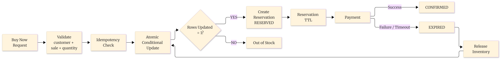
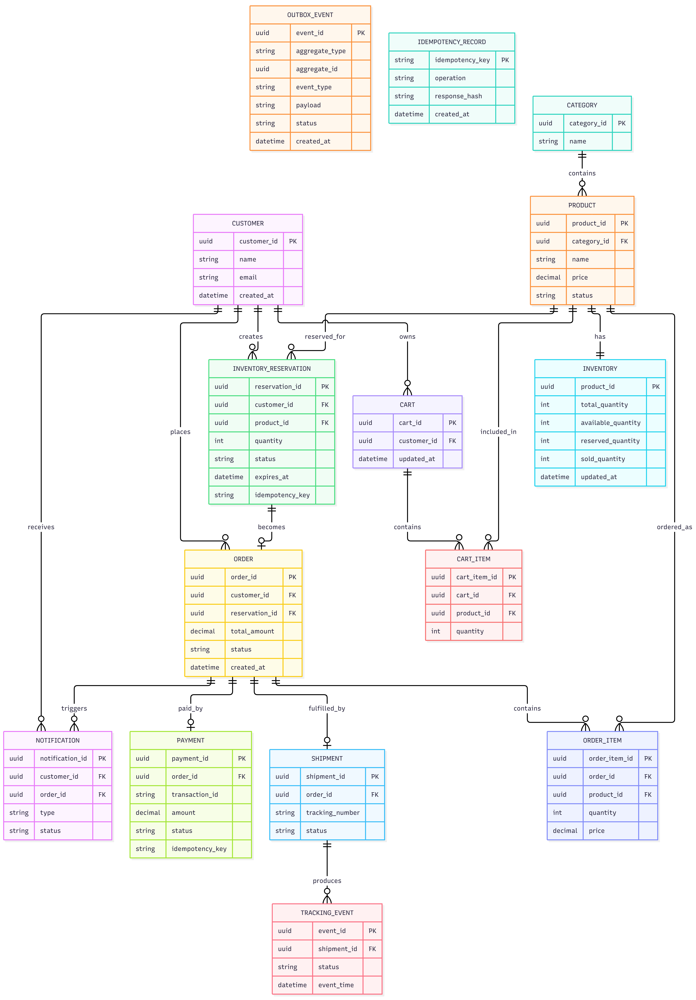
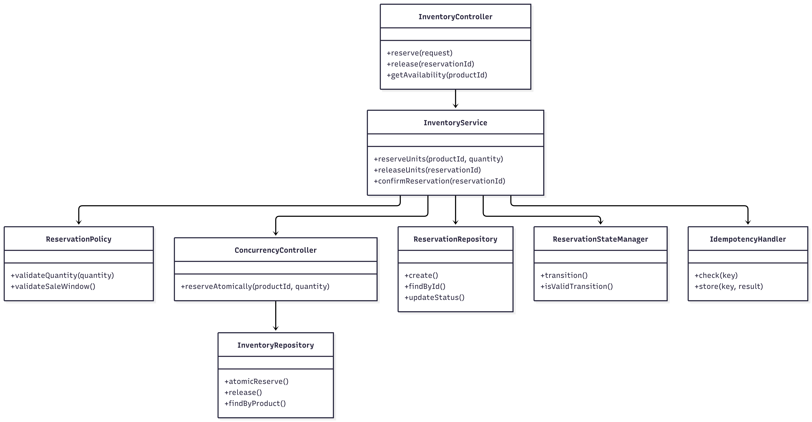
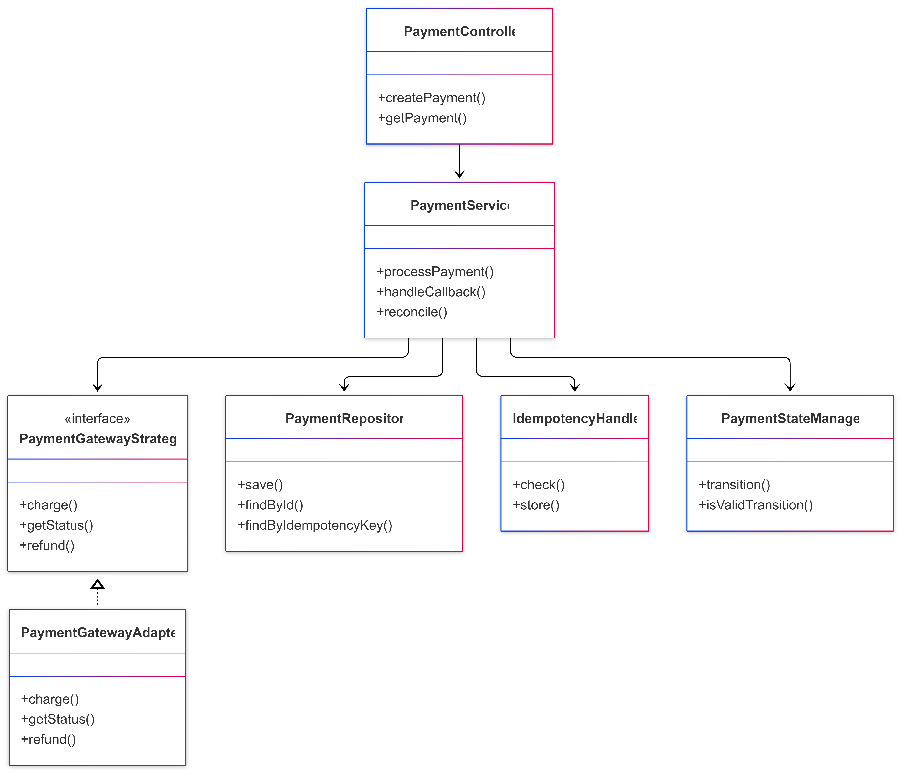
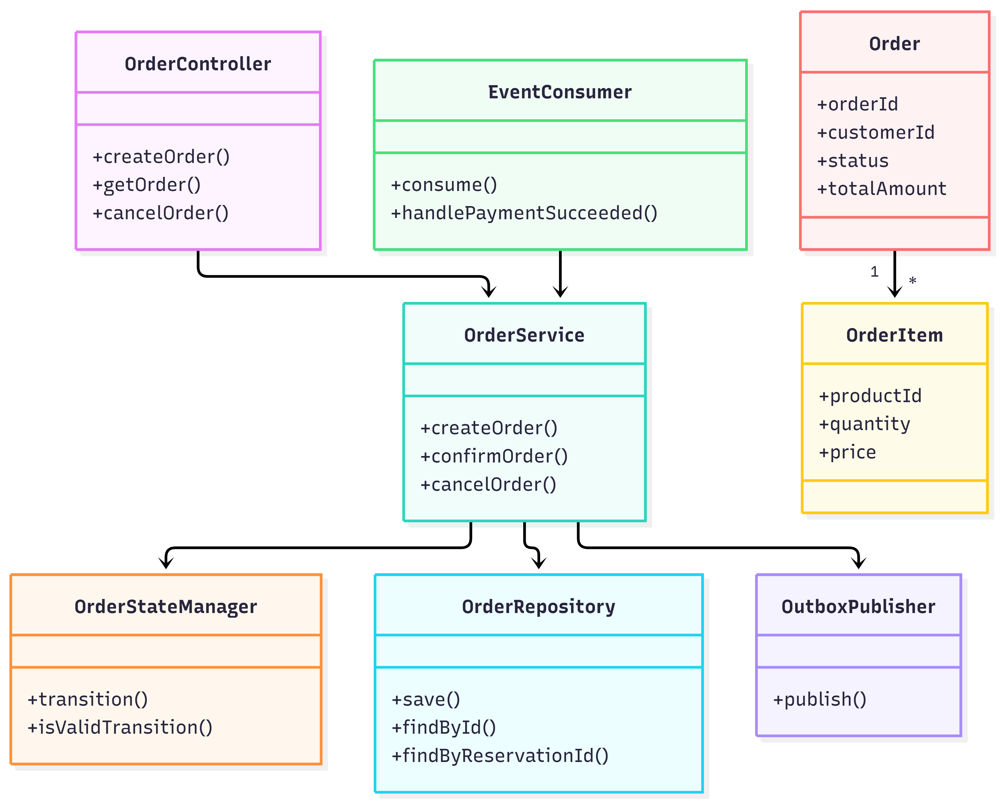
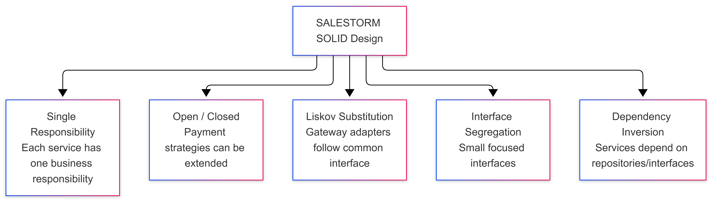
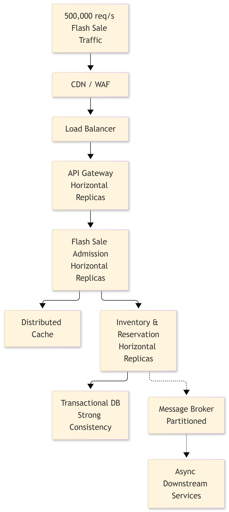
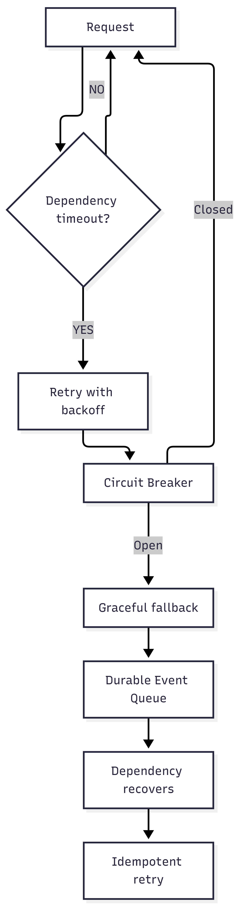
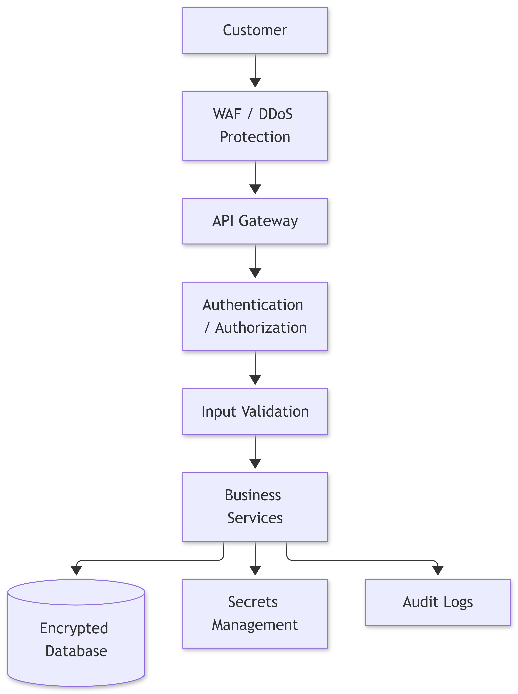
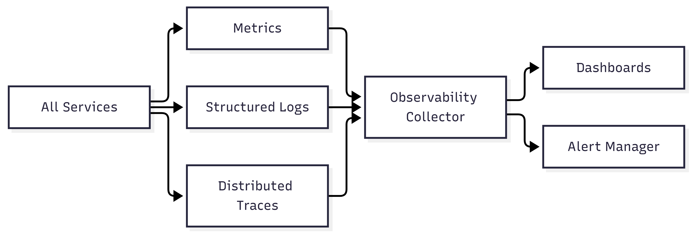

# SALESTORM: High-Scale Flash Sale Platform System Design

A comprehensive, production-grade system architecture and low-level design for a high-concurrency e-commerce flash sale platform. Engineered to withstand extreme write contention (e.g., **10,000+ concurrent users competing for 100 inventory units** and **500,000 req/s flash sale peak traffic**) while strictly guaranteeing zero overselling, idempotency, high availability, and eventual consistency.

---

## 📑 Table of Contents
1. [Executive Summary & Problem Statement](#executive-summary--problem-statement)
2. [High-Level Architecture (HLD) & C4 Model](#high-level-architecture-hld--c4-model)
3. [Key Architectural Decisions: Concurrency Control](#key-architectural-decisions-concurrency-control)
4. [Database Architecture & Data Model (ERD)](#database-architecture--data-model-erd)
5. [Low-Level Design (LLD) & Class Diagrams](#low-level-design-lld--class-diagrams)
6. [State Machines & Lifecycles](#state-machines--lifecycles)
7. [Sequence & Interaction Flows](#sequence--interaction-flows)
8. [Design Patterns & SOLID Principles](#design-patterns--solid-principles)
9. [Non-Functional Requirements (NFRs)](#non-functional-requirements-nfrs)
   - [Scalability Strategy](#scalability-strategy)
   - [Reliability & Fault Tolerance](#reliability--fault-tolerance)
   - [Security Architecture](#security-architecture)
   - [Observability & Monitoring](#observability--monitoring)
10. [Repository Artifacts Index](#repository-artifacts-index)

---

## 1. Executive Summary & Problem Statement

Flash sales introduce unique distributed systems challenges characterized by:
- **Spike Traffic:** Massive read & write bursts within milliseconds of sale launch (500,000+ req/s at ingress).
- **Extreme Write Contention:** Thousands of concurrent requests attempting to decrement a single inventory counter.
- **Strict Business Constraints:** Zero overselling, strict purchase limits per user, guaranteed idempotency across network retries, and resilient payment reconciliation.
- **Dual-Write Hazards:** Preventing inconsistent states between database updates, payment gateways, and asynchronous event notifications.

SALESTORM solves these challenges using **Edge Filtering**, **Admission Control**, **Atomic Conditional SQL Updates**, **Temporary Reservations with TTL**, **Transactional Outbox Event Streaming**, and **Asynchronous Payment Reconciliation**.

---

## 2. High-Level Architecture (HLD) & C4 Model

### System Context
The platform interacts with end customers via Web and Mobile apps, orchestrating requests across internal domains and integrating securely with external providers:
- **Payment Gateway** (e.g., Stripe / Razorpay / Adyen)
- **Delivery Partner** (Logistics & shipping dispatch)
- **Notification Provider** (Email, SMS, Push notification providers)


### High-Level Architecture (HLD)
The platform is organized into three primary operational tiers:
1. **Edge Tier:** CDN & WAF for DDoS protection, static caching, and TLS termination, routing through Load Balancers to an API Gateway cluster.
2. **Microservices Business Tier:**
   - **Product Service & Distributed Cache:** Read-heavy catalog queries backed by Redis clusters.
   - **Cart Service:** Session-based user carts.
   - **Flash Sale Admission Service:** Token-bucket rate limiting and bot mitigation before traffic hits core inventory.
   - **Inventory & Reservation Service:** The **Critical Consistency Boundary** managing real-time stock counters and short-lived reservation locks.
   - **Checkout & Payment Service:** Payment orchestration, idempotency keys, and gateway adapters.
   - **Order Service:** Order lifecycle management, fulfillment handoff, and historical record tracking.
   - **Fulfilment, Shipment & Delivery Tracking Services:** Downstream asynchronous delivery status pipelines.
   - **Notification Service:** Consumer of platform events to notify customers.
3. **Data & Messaging Tier:**
   - Transactional Relational Database (Primary for writes with read replicas).
   - Partitioned Message Broker (Kafka / RabbitMQ) for decoupled async domain events.
   - Distributed Cache (Redis) for low-latency read models.
   - Observability Platform (Prometheus, OpenTelemetry, Grafana).


### Container Architecture
Illustrates container boundaries, synchronous REST/gRPC interfaces, transactional database writes, and durable asynchronous event streams (`Reservation events`, `Payment events`, `Order events`).


---

## 3. Key Architectural Decisions: Concurrency Control

### Scenario: 10,000 Concurrent Users Competing for 100 Stock Units
A core architectural dilemma during flash sales is selecting the optimal concurrency control mechanism for the inventory decrement operation:

| Criterion | Option A: Pessimistic Row Lock (`SELECT FOR UPDATE`) | Option B: Distributed Lock (Redis / Redlock) | Option C: Atomic Conditional Update (Selected) |
| :--- | :--- | :--- | :--- |
| **Mechanics** | Locks database row until transaction completes. | Acquires distributed lock before executing DB write. | Single atomic query: `UPDATE inventory SET available = available - 1 WHERE product_id = :id AND available >= 1;` |
| **Contention Behavior** | Heavy thread queueing, connection exhaustion, lock contention latency. | Network hops per attempt, lease expiry/drift risks, split-brain failure modes. | Database engine manages atomic row update at hardware/engine speed. |
| **Complexity** | High database resource consumption under peak load. | High operational complexity, consensus management, fallback locks. | Minimal complexity, native database ACID guarantee. |
| **Decision** | Rejected due to thread starvation at 10k concurrency. | Rejected due to split-brain risks and distributed coordination overhead. | **ADOPTED: Maximum throughput, zero lock coordination overhead, absolute consistency.** |


### Flash Sale Inventory Reservation Flow
1. Check customer eligibility and validate request.
2. Verify idempotency record.
3. Execute atomic conditional update on primary DB:
   ```sql
   UPDATE inventory 
   SET available = available - 1 
   WHERE product_id = :product_id AND available >= 1;
   ```
4. If rows affected = 1: Create `INVENTORY_RESERVATION` with status `RESERVED` and a 10-minute TTL. Hand off to Checkout/Payment.
5. If rows affected = 0: Immediately return `OUT_OF_STOCK` (HTTP 409 / 410) without expensive locking.
6. On payment timeout or failure: Release reservation and increment inventory back to the pool.



---

## 4. Database Architecture & Data Model (ERD)

The relational schema ensures 3NF normalization, transactional integrity, and auditable event persistence:

- **CUSTOMER & CATEGORY & PRODUCT:** Core master catalog entities.
- **INVENTORY:** Tracks `total_quantity`, `available_quantity`, and `reserved_quantity` per product.
- **INVENTORY_RESERVATION:** Ephemeral reservation records with `ttl_expires_at`, `status` (`RESERVED`, `CONFIRMED`, `RELEASED`), and `idempotency_key`.
- **CART & CART_ITEM:** Temporary holding state prior to flash sale checkout.
- **ORDER & ORDER_ITEM:** Authoritative immutable order records post-payment.
- **PAYMENT:** Payment tracking with provider transaction IDs, gateway responses, and amount reconciliation.
- **SHIPMENT & TRACKING_EVENT:** Post-order logistics tracking.
- **OUTBOX_EVENT:** Enables the **Transactional Outbox Pattern** to eliminate dual-write hazards between database commits and message broker publishing.
- **IDEMPOTENCY_RECORD:** Dedicated store for deduplicating repeated API calls and webhook callbacks.



---

## 5. Low-Level Design (LLD) & Class Diagrams

### Inventory Service Class Design
Components include `InventoryController`, `InventoryService`, `ReservationPolicy`, `ConcurrencyController` (encapsulating atomic SQL execution), `InventoryRepository`, `ReservationRepository`, `ReservationStateManager`, and `IdempotencyHandler`.



### Payment Service Class Design
Encapsulates `PaymentController`, `PaymentService`, `PaymentGatewayStrategy` interface with polymorphic adapters (`StripeAdapter`, `RazorpayAdapter`, `PayPalAdapter`), `PaymentRepository`, `PaymentStateManager`, and `IdempotencyHandler`.



### Order Service Class Design
Includes `OrderController`, `EventConsumer` (consuming `PaymentSucceeded` events), `OrderService`, `OrderStateManager`, `OrderRepository`, and `OutboxPublisher`.



### Payment Component & Reconciliation Architecture
Highlights the internal structure of the Payment Service, including the asynchronous Reconciliation Loop that queries external payment gateways to resolve ambiguous pending transactions.


---

## 6. State Machines & Lifecycles

### Order State Machine
Defines valid transitions from inception to delivery:
`CREATED` &rarr; `PAYMENT_PENDING` &rarr; `CONFIRMED` &rarr; `PROCESSING` &rarr; `SHIPPED` &rarr; `OUT_FOR_DELIVERY` &rarr; `DELIVERED`.
Supports terminal branches: `CANCELLED` and `REFUNDED`.


### Reservation State Machine
Governs ephemeral stock holds:
`RESERVED` &rarr; `PAYMENT_PENDING` &rarr; `CONFIRMED` &rarr; `SOLD`.
On expiration (TTL elapsed) or payment failure: transitions directly to `RELEASED` with stock rollback.


---

## 7. Sequence & Interaction Flows

### End-to-End Flash Sale Purchase Flow
Walks through the entire request lifecycle: API Gateway admission &rarr; Inventory atomic reservation &rarr; Checkout initiation &rarr; Payment execution &rarr; Order creation &rarr; Out of stock handling.


### Payment Processing & Reconciliation Flow
Covers normal payment authorization, immediate card declines, and ambiguous network timeouts. Timeout cases trigger asynchronous gateway status reconciliation before confirming or releasing inventory holds.


### Resilient Order Processing with Transactional Outbox
Demonstrates system resilience during a downstream outage (e.g., Order Service down for 30 seconds). Payment events are reliably queued in the database outbox and published once consumers recover, ensuring zero data loss.


---

## 8. Design Patterns & SOLID Principles

### Design Patterns Applied
- **Repository Pattern:** Abstracting storage and database operations behind domain-driven interfaces.
- **Strategy Pattern:** Dynamic runtime selection of third-party payment gateways.
- **Adapter Pattern:** Translating generic payment requests into vendor-specific API formats.
- **State Pattern:** Encapsulating state machine transitions for Orders, Payments, and Reservations.
- **Factory Pattern:** Dynamic instantiation of payment adapters and notification formatters.
- **Observer / Event-Driven Pattern:** Decoupling core checkout from downstream notifications and analytics.
- **Facade Pattern:** Unified checkout orchestration across inventory, pricing, and payment.
- **Circuit Breaker Pattern:** Protecting internal services against upstream/downstream cascading failures.


### SOLID Principles Compliance
- **S - Single Responsibility:** Each microservice and class manages a single cohesive capability.
- **O - Open/Closed:** New payment providers or notification channels can be added without modifying existing core logic.
- **L - Liskov Substitution:** All payment gateway adapters can be interchangeably used through `PaymentGatewayStrategy`.
- **I - Interface Segregation:** Lean, client-specific interfaces prevent service coupling to unneeded methods.
- **D - Dependency Inversion:** High-level domain services depend on domain abstractions rather than database or transport implementations.



---

## 9. Non-Functional Requirements (NFRs)

### Scalability Strategy
Horizontal scaling from edge to data tier:
- 500,000 req/s filtered by CDN/WAF.
- Elastic API Gateway replicas behind Layer 4 / Layer 7 load balancers.
- Flash Sale Admission queues to rate-limit raw hits.
- Distributed Redis caching for static product metadata.
- Primary Transactional DB optimized for atomic write updates with read replicas for catalog browsing.
- Partitioned Message Broker for asynchronous downstream consumption.



### Reliability & Fault Tolerance
Multi-layered failure mitigation:
- Request timeout detection.
- Exponential backoff with jitter on retries.
- Circuit breaker trip mechanisms (`Closed` &rarr; `Open` &rarr; `Half-Open`).
- Graceful fallbacks and durable event queues for asynchronous retry after recovery.



### Security Architecture
Defense-in-depth security model:
- WAF & DDoS mitigation at network ingress.
- API Gateway token validation and rate limiting.
- Centralized Authentication & RBAC / ABAC Authorization.
- Strict input validation and sanitization.
- Secrets management (HashiCorp Vault / Cloud KMS).
- Data-at-rest and data-in-transit encryption.
- Tamper-evident audit logging for all transactional events.



### Observability & Monitoring
Unified telemetry pipeline:
- Service metrics (throughput, error rates, p95/p99 latencies).
- Structured JSON logging with trace IDs.
- Distributed tracing (OpenTelemetry / Jaeger).
- Centralized observability collector, alerting engines, and operational dashboards.



### Multi-Zone High-Availability Deployment
Multi-AZ production deployment topology featuring redundant edge nodes, autoscaling application pods across availability zones, Multi-AZ database failover, and active-active cache replicas.


---

## 10. Repository Artifacts Index

| Artifact | Category | Description |
| :--- | :--- | :--- |
| [`System Context Diagram.png`](./System%20Context%20Diagram.png) | Architecture (HLD) | System context and external ecosystem integrations. |
| [`HLD.png`](./HLD.png) | Architecture (HLD) | Complete microservices platform architecture. |
| [`Container img.png`](./Container%20img.png) | Architecture (HLD) | C4 Container diagram and inter-service communication. |
| [`Deployment.png`](./Deployment.png) | Infrastructure | Multi-AZ high-availability deployment topology. |
| [`Architecture Decision.png`](./Architecture%20Decision.png) | Architecture Decision | Trade-off analysis for high-concurrency inventory reservation. |
| [`Inventory.png`](./Inventory.png) | Core Flow | Concurrency management and atomic update logic. |
| [`Database.png`](./Database.png) | Data Model | Relational schema and entity-relationship diagram (ERD). |
| [`LLD-Inventory.png`](./LLD-Inventory.png) | Low-Level Design | Class diagram and internal interfaces for Inventory Service. |
| [`LLD-Payment.png`](./LLD-Payment.png) | Low-Level Design | Class diagram and strategy pattern for Payment Service. |
| [`LLD-order.png`](./LLD-order.png) | Low-Level Design | Class diagram and domain models for Order Service. |
| [`Payment Component.png`](./Payment%20Component.png) | Low-Level Design | Internal components, outbox publisher, and reconciliation loop. |
| [`Order state.png`](./Order%20state.png) | State Machine | Complete order lifecycle and transitions. |
| [`reservation state.png`](./reservation%20state.png) | State Machine | Inventory reservation state transitions and TTL expiry. |
| [`Purchase seq.png`](./Purchase%20seq.png) | Sequence Diagram | End-to-end flash sale purchase sequence. |
| [`Payment seq.png`](./Payment%20seq.png) | Sequence Diagram | Payment authorization, timeout, and reconciliation sequence. |
| [`Order seq.png`](./Order%20seq.png) | Sequence Diagram | Resilient outbox event delivery during consumer downtime. |
| [`API.png`](./API.png) | API Design | API Gateway endpoint mapping and service routing. |
| [`Design pattern.png`](./Design%20pattern.png) | Design Principles | Gang of Four design patterns implementation map. |
| [`Solid.png`](./Solid.png) | Design Principles | SOLID principles implementation breakdown. |
| [`Scalability.png`](./Scalability.png) | NFR | Ingress-to-database scaling under 500k req/s. |
| [`Reliability.png`](./Reliability.png) | NFR | Fault tolerance, retry with backoff, and circuit breaker flow. |
| [`Security.png`](./Security.png) | NFR | Layered defense and security architecture. |
| [`Observability.png`](./Observability.png) | NFR | Metrics, structured logs, distributed traces, and alerts. |
| [`System Design-Document.pdf`](./System%20Design-Document.pdf) | Documentation | Full comprehensive system design specification document. |
| [`System Design Hackathon - PPT.pdf`](./System%20Design%20Hackathon%20-%20PPT.pdf) | Presentation | System design hackathon pitch and architectural slide deck. |
